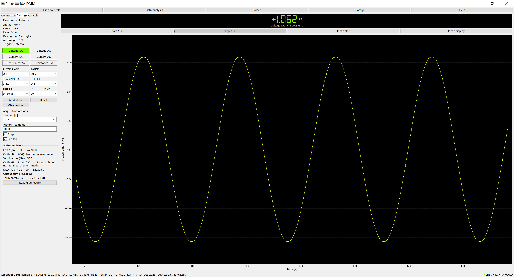
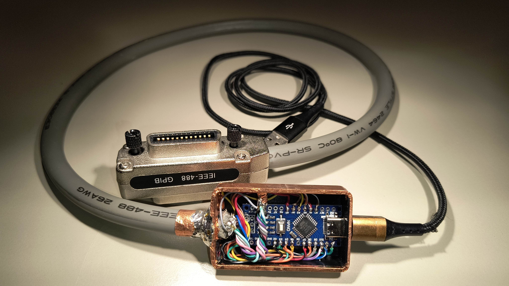
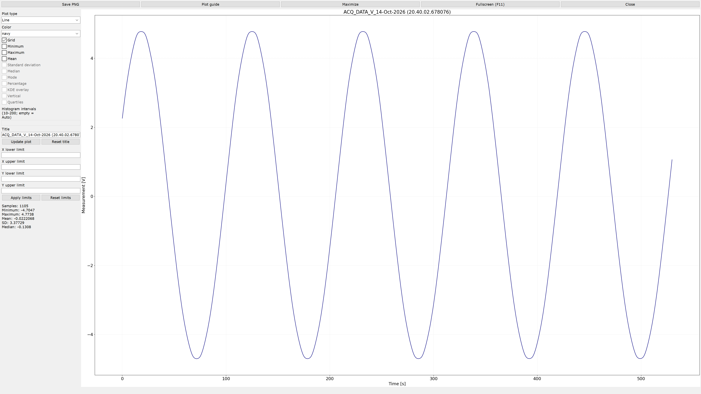

# FLUKE 8840A DMM GUI

A Python-based graphical user interface (GUI) designed to control and monitor 
the **Fluke 8840A Digital Multimeter** via an **AR488 GPIB-to-Serial controller**. 



## AR488 GPIB controller
To write and debug the GPIB interface, I built a GPIB controller using an Arduino 
Nano Clone CH340G and firmware provided by 
[Twilight-Logic](https://github.com/Twilight-Logic/AR488).



## Install and run

Use Python 3.10 or later with Tkinter:

```bash
python -m pip install -r requirements.txt
python Main.py
```

On Linux, install your distribution's Tkinter package if needed, such as
`python3-tk`. The tooltip module uses the standard Python `idlelib` package,
which may require the distribution's IDLE package. On Windows, Tkinter and IDLE
are normally included with Python.

To try the program without an instrument:

```bash
python Main.py --demo --no-sound
```

Select **SIMULATED**, click **Connect**, choose a function, then click **Start
ACQ**. Demo mode never opens a physical serial device. `--windowed` starts in a
resizable window.


## Communication and COM ports

Available serial ports are discovered using pySerial, refreshed automatically
and sorted naturally (COM2 before COM10). Detection does not open ports. The
current port remains selected during a connection. The default GPIB address is
1; select the instrument's configured address (1-30) before connecting.
Address zero is reserved for the controller.

The connection opens with `AR488(port, timeout=config.query_timeout, debug=False)` 
and then calls `address(address)`. The configured response timeout is 1 second.
PyAR488 opens the selected COM port at 115200 baud, waits for the board and
reads its existing configuration. Opening the port retains the driver's serial
timeout properties. During a measurement, serial reads are temporarily
nonblocking so the instrument layer enforces the complete response deadline,
then the original serial read timeout is restored.

ASCII commands are strings and are sent through the driver's actual
`bus_write` method, using  `\n` linefeed.

```python
self._interface.bus_write(command.rstrip("\r\n") + "\n")
```

The appended character is LF (`"\n"`). The driver performs ASCII encoding and
adds its own LF/CR, preserving the original serial ending. Controller text uses
`bus_read()`. Fluke ASCII replies use `bus_read(decode=False)` with a byte buffer,
then ASCII decoding, so fragmented replies can be reassembled. Ordinary replies
do not use direct raw serial reads. After a complete response, the transport
drains already available trailers with a short availability check. Unrecognized
trailer byte values do not reject the connection.

The handshake preserves the supplied Fluke program's controller version,
reset and identification sequence, then reads the complete status group:

```text
++ver
*
G8
++read
G0
++read
G5
++read
G7
++read
G4
++read
G1
++read
G6
++read
```

`G2` is appended only when `G4` reports active calibration without verification.

`G8` verifies that the connected instrument identifies itself as an 8840A.
There are no additional controller framing/configuration writes at startup.
Errors identify the COM port, GPIB address and failed stage. Reply deadlines
are 1 second; an incomplete or malformed transaction closes the port.


## Instrument settings and actual status

Function buttons and combobox selections send their commands immediately. 
Before requesting status, the I/O worker waits 500 ms, then reads `G0`, `G5`, 
`G7`, `G4`, `G1` and `G6`. The wait occursbefore `G0`, so readback reflects 
the settled configuration. The GUI remains responsive.Demo mode does not require
 this hardware delay.

Comboboxes, measurement labels and the green function button follow the
returned status. Programmatic synchronization does not send commands back.
**Current DC**, for example, sends `F5`, then `R0`, then reads the complete status group.

| Function | Command | Available ranges |
| --- | --- | --- |
| Voltage DC | F1 | 200 mV, 2 V, 20 V, 200 V, 1000 V |
| Voltage AC | F2 | 200 mV AC, 2 V AC, 20 V AC, 200 V AC, 700 V AC |
| Resistance 2w | F3 | 200 Ω, 2 kΩ, 20 kΩ, 200 kΩ, 2 MΩ, 20 MΩ |
| Resistance 4w | F4 | 200 Ω, 2 kΩ, 20 kΩ, 200 kΩ, 2 MΩ, 20 MΩ |
| Current DC | F5 | 2000 mA |
| Current AC | F6 | 2000 mA |

Voltage/resistance manual ranges use `R1` through `R5`/`R6`; current uses
`R5`. **Autorange ON** sends `R0`. **Autorange OFF** sends `R7`, retaining the
current range. **Offset OFF/ON** sends `B0/B1`. **Instrument display ON/OFF**
sends `D0/D1`. **Reset** sends `*`; **Clear errors** sends `X0`.

The Trigger combobox has five descriptive choices, each mapped to its actual
numeric Fluke code:

| Displayed choice | Command | Rear trigger | Settling delay |
| --- | --- | --- | --- |
| Internal | T0 | Disabled | Not used |
| External with Delay | T1 | Enabled | Enabled |
| Bus with Delay | T2 | Disabled | Enabled |
| External without Delay | T3 | Enabled | Disabled |
| Bus without Delay | T4 | Disabled | Disabled |

Fluke `G0` reports the exact trigger code.

| Register | Format | Interpretation |
| --- | --- | --- |
| G0 | FRST | Function 1–6, actual range 1–6, reading rate 0–2, trigger 0–4 |
| G5 | 1IAB | I: 0 front / 1 rear; A: 0 autorange ON / 1 OFF; B: 0 offset OFF / 1 ON |
| G1 | nn | SRQ mask, decimal 00–63 |
| G2 | Signed number with exponent and optional suffix | Expected calibration input; valid only in active calibration without verification |
| G4 | 10vm | Calibration verification flag and calibration mode |
| G6 | 10yw | Output suffix flag and terminator selection |
| G7 | 10nn | Error code; reading it does not clear the register |
| G8 | FLUKE,8840A,0,Vn.n | Instrument identification and interface firmware |

**Inputs**, **Offset**, **Rate**, **Resolution**, **Autorange** and **Trigger**
are in Settings under **Measurement status**. Trigger is directly below
Autorange. **TRIGGER** and **INSTR DISPLAY** share a two-column row, using
the same responsive layout as **READING RATE** and **OFFSET**. Narrow windows
stack all setting fields into one column.
Display mode shows the last known command because `G0/G5` do not report it.

The **Status registers** group updates automatically on connection, after
settings/custom commands, and with **Read status** or **Read diagnostics**.
Separate English labels describe the error code (`G7`), calibration and
verification modes (`G4`), calibration input (`G2`), SRQ mask (`G1`), suffix
and terminators (`G6`). Reading `G7` does not clear errors. The SRQ mask label
decodes combined values, for example `33 — Overrange, Any error`. Its weights
are 1 (overrange), 2 (reserved, not used), 4 (front panel SRQ), 8 (calibration
step complete), 16 (data available) and 32 (any error).

`G2` is queried only when `G4` reports an active calibration mode and verification
is OFF. In normal measurement mode and during calibration verification, its
label explains why the prompt is unavailable. This avoids generating errors
51/54 just by reading status. Valid instrument errors returned by `G2` are
shown in the labels without closing a healthy connection. These reads do not
enable calibration, clear errors or write calibration data.


## Numeric display and acquisition

`digital-7.ttf` is included and rendered directly through Pillow, without an
operating-system font installation. Units use the shared interface font so Ω
is readable. Digital-7 is by Sizenko Alexander (Style-7); the author's original
license is included in `DIGITAL7_FONT_LICENSE.txt`.

Fluke numeric replies are already in volts, amps or ohms, including readings
from the 2000 mA range. Optional `Y1` suffixes are supported. Overrange readings
show **OVERLOAD**, are excluded from live plot scaling and retain their original
numeric value in CSV. Replies such as `+1.0032E+21` report instrument error 32
and are never plotted as measurements.

In internal trigger mode, acquisition sends `++read`. In `T1` through `T4`, it
sends `?`, then `++read`, **MAX** adds no sampling interval delay; numeric intervals 
are in seconds.

The acquisition thread handles I/O and complete CSV logging. Tkinter receives
updates through a queue; workers never touch widgets. The plot scrolls through
the latest 100 samples by default, with larger selectable histories. Plot history
and GUI refresh do not limit CSV logging. Stop interrupts interval waits; an
in-progress reply is allowed to finish or time out. Closing stops acquisition,
closes the logger and releases the serial port.

The main window expands to the available screen and uses resizing grid cells,
reflowing buttons and scrollable settings. On narrow windows, **Controls**
toggles the bounded main control pane so the waveform keeps most of the space.
Labels, Entry fields and Combobox fields/drop-downs share the same readable font.
The numeric reading, unit and caption fit separate areas without overlap.


## Custom commands, files and Data Analysis

**Custom command** supports Send and Enter, with an optional reply read.
Controller `++ver` and `++read` are read without inserting duplicate reads.
Each completed custom operation refreshes measurement status. Controller
connection/framing changes are managed by the application. Use Fluke `W0`
termination (CR/LF/EOI); custom `W1`–`W7` changes are rejected so subsequent
readline-based transactions retain a supported termination format.

Preferences are stored in the dedicated `settings.ini` file. Output is saved
under `<selected program folder>/Fluke_8840A_DMM/OUTPUT`. The CSV headers are
`MEASURE[V/A/Ohm],TIMESTAMP[s]`. Capture names include microseconds, 
and capture/PNG filenames do not overwrite existing outputs.

Data Analysis supports Line, Histogram, KDE, Box and Violin plots. It retains
color, grid, statistics, extrema, histogram bins/percentage/KDE overlay,
orientation, quartiles, title and axis limits. Controls are always visible in
a scrollable pane; there is no hide-controls feature in this window.
Use **Update plot** or Enter for analysis text fields, **Apply limits** for
axis limits and **Reset limits** for automatic scaling.

For **Line** only, minimum, maximum, mean, sample standard deviation and the
sidebar statistics use the original samples inside all applied limits. X-only
limits select timestamps; Y-only limits select values; combined limits use
their intersection. Samples exactly on the limits are included. The complete
waveform remains plotted and is clipped to the selected bounds. An empty
selection shows **No samples in the selected area**, with no misleading
markers or statistics. A single selected sample has zero standard deviation.
**Reset limits** restores full-capture statistics. Changing **Plot type** clears
all applied X/Y limits and all four limit entry fields. Color, marker and title
changes preserve the current limits. PNG exports use the same selected statistics.

The analysis window supports native maximize, **Maximize**, **Fullscreen (F11)**
and **Esc**. Moving it does not rebuild the plot. Actual size changes are
coalesced over 100 ms. Interactive rendering uses a 96 dpi base figure with
Tk display scaling; **Save PNG** exports separately at 300 dpi. Plot labels,
ticks, legends and annotations are at least as large as the shared button text.
Single-reading and constant-value captures are supported.




## Main classes and modules

- `app.py` — `DmmApplication` -> Compose services and handle GUI actions/lifecycle  
- `instrument.py` — `Fluke8840A` -> Complete serialized Fluke transactions and readback  
- `transport.py` — `InstrumentTransport`, `AR488Transport`, `SimulatedTransport` -> Driver I/O and demo simulation  
- `config.py` -> Immutable function/range definitions and command mappings  
- `status.py` — `StatusDecoder`, `DiagnosticsDecoder`, `MeasurementDecoder` -> Validate ASCII registers, errors and readings  
- `models.py` -> Immutable snapshots, measurements and bounded trace history  
- `acquisition.py` — `AcquisitionController` -> Sampling, cancellation and logging lifecycle  
- `storage.py` -> Preferences, output paths and CSV persistence  
- `plot.py`, `display.py` -> Scrolling waveform and Digital-7 numeric display  
- `analysis.py`, `analysis_ui.py`, `canvas.py` -> Scientific analysis, controls and efficient resizing  
- `ui.py`, `widgets.py`, `layout.py` -> Responsive interface panels  
- `ports.py`, `tasks.py`, `dialogs.py` -> COM discovery, callback queue and shared GUI services  


## Unit Testing

```bash
python -m unittest discover -s tests -v
```
- `test_acquisition.py` -> 15 Tests
- `test_analysis_window.py` -> 12 Tests
- `test_data.py` -> 19 Tests
- `test_display.py` -> 4 Tests
- `test_protocol.py` -> 29 Tests
- `test_sync.py` -> 14 Tests
- `test_transport.py` -> 9 Tests


## Protocol references
- [Fluke 8840A instruction's manual](docs/fluke-8840a-manual.pdf)
- [AR488 developer manual](https://twilight-logic.github.io/AR488/)


## Driver dependency
- [PyAR488](https://pypi.org/project/PyAR488/)


### License
This project is licensed under the **MIT License** - see the `LICENSE` file for details. 
You are free to use, modify, and distribute this software, even for commercial purposes, 
as long as the original copyright notice is retained.


### Contributions
Contributions, bug reports, and hardware compatibility feedback are highly appreciated! 

Since the codebase has been structured with independent, decoupled classes (protocol, 
transport, acquisition, etc.), please maintain this clean object-oriented architecture 
when submitting changes.

* **Reporting Bugs**: Open an **Issue** on the repository. If you experienced a communication 
failure, please copy and paste the exact *Connection failed…* message from your Console to 
help distinguish serial/controller issues from DMM handshake errors.
* **Submitting Code**: **Fork** the repository, create a dedicated feature branch, and submit 
a **Pull Request**. For major architectural changes, please open an Issue first to discuss 
your proposal.